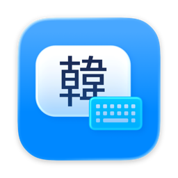

<p align="center">
  
</p>

# 우리입력기

`woorilee`는 macOS용 한국어 입력기입니다. 입력 방식은 두벌식 한글 조합을 기본으로 하며, `InputMethodKit` 기반 입력기 프로세스 안에서 한글 조합, 수동 한자 변환, Kiwi 형태소 분석 기반 실시간 한자 변환을 처리합니다. 한자 후보는 사전 빈도뿐 아니라 주변 문맥(코퍼스 연관표, 고유명사 사전 정보, 현재 세션에서 입력한 어휘)을 함께 보고 정렬합니다.

## 경고

이 프로젝트는 소프트웨어 개발 경험이 없는 사람이 시작했으며, 코드의 상당 부분을 AI가 생성했습니다. 코드 품질이나 안정성에 대한 전문적인 검증을 거치지 않았으므로, 소스 코드를 무조건 신뢰해서는 안 됩니다. 일상적으로 안정적인 한국어 입력기가 필요하다면 macOS 기본 입력기나 검증된 서드파티 입력기를 사용하는 것을 권장합니다. 이 프로젝트는 실험적 성격이 강하며, 예기치 않은 동작이나 버그가 있을 수 있습니다.

한자 자동 변환 정확도도 아직 검증 중입니다. 2026-11-15 기준 73행 독립 검수에서 자동 변환 정밀도는 72.7%(채점 가능 44행 중 32행)였고, 실제 호스트 앱에서의 입력 지연과 동작은 아직 체계적으로 검증하지 않았습니다. 자세한 내용은 [`docs/hanja-improvement-progress-2026-11-15.md`](docs/hanja-improvement-progress-2026-11-15.md)를 참고하세요.

## 주요 기능

- 두벌식 한글 조합과 확정, 클라이언트별 조합 상태 관리
- 수동 한자 변환(`Option+Return`)과 후보 패널: 선택 영역 또는 커서 왼쪽 단어를 변환하며, 조합 중에도 바로 변환할 수 있음
- Kiwi 형태소 분석 기반 실시간 한자 변환(메뉴 또는 `Control+A`로 켜고 끔)
- 문맥 기반 후보 정렬: 코퍼스 연관표, 고유명사 사전 정보, 세션 어휘와 직전 선택을 반영. 근거가 부족하거나 고유어와 소리가 같은 읽기는 자동 변환을 보류
- 실시간 변환 중 `Shift+←/→`로 문절 경계 조정
- 숫자 입력용 數字 후보(자릿수 읽기, 단위 읽기, 한자·한글 단위 혼용)
- 오늘·어제·내일 같은 상대 날짜 표현의 날짜 표기 후보(9종)
- 사용자 한자 사전 편집 창, 사용 빈도 기반 후보 랭킹, 학습 데이터 초기화
- Sparkle 기반 자동 업데이트

## 설치

[GitHub Releases](https://github.com/twoprom/woorilee/releases)에서 최신 `woorilee.zip`을 받으세요. macOS 26.0 이상이 필요합니다. zip 파일 안의 `.app` 번들을 `/Library/Input Methods/` 또는 `~/Library/Input Methods/`로 복사한 뒤 다시 로그인하세요.

## 업데이트

메뉴 막대의 입력 소스 아이콘을 클릭한 뒤 `우리입력기에 관하여`를 선택하면 현재 버전을 확인하고 새 버전으로 업데이트할 수 있습니다.

## 사용법

### 입력기 활성화

1. 시스템 설정 → 키보드 → 입력 소스 → `편집…`으로 이동합니다.
2. 왼쪽 하단의 `+` 버튼을 눌러 입력 소스를 추가합니다.
3. 한국어 목록에서 `두벌式`을 선택하고 추가합니다.
4. 메뉴 막대의 입력 소스 아이콘을 클릭하거나 `Ctrl+Space`로 우리입력기를 선택합니다.
5. 처음 설치한 경우 보안 경고가 나타납니다. 시스템 설정 → 개인정보 보호 및 보안 → `그래도 열기`를 누르세요.

### 입력기 메뉴

우리입력기가 선택된 상태에서 메뉴 막대의 입력 소스 아이콘을 누르면 다음 항목이 있습니다.

| 메뉴 | 설명 |
| --- | --- |
| `실시간 변환` (`Control+A`) | 실시간 한자 변환을 켜고 끕니다. 기본값은 꺼짐입니다. |
| `漢字 사전 편집…` | 사용자 한자 항목을 추가·수정·삭제합니다. |
| `사용자 학습 데이터 초기화…` | 후보 선택으로 쌓인 사용 빈도 데이터를 지웁니다. |
| `우리입력기에 관하여` | 버전 확인과 업데이트 |

문맥 기반 후보 정렬은 별도 설정 없이 항상 적용됩니다.

### 한글 입력

일반적인 두벌식 자판 배열로 한글을 입력합니다. 조합 중인 글자는 밑줄이 표시되며, `Space`, `Return`, 화살표 키 등을 누르면 조합이 확정됩니다. `Command`·`Control` 조합키는 조합을 확정한 뒤 앱으로 그대로 전달됩니다.

### 수동 한자 변환

한글을 입력한 뒤(또는 변환할 글자를 선택한 뒤) `Option+Return`을 누르면 한자 후보 패널이 열립니다. 실시간 변환이 켜져 있어도 `Option+Return`은 같은 방식으로 동작하며, 입력 중이던 실시간 절은 한글 원문으로 확정한 뒤 변환합니다.

| 키 | 동작 |
| --- | --- |
| `↑` / `↓` | 후보 이동. 강조한 후보가 문서에 바로 반영됩니다. |
| `←` / `→`, `Tab` / `Shift+Tab` | 이전·다음 페이지 |
| `1`–`9` | 해당 번호의 후보로 확정 |
| `0` | 한글 그대로 확정 |
| `Return` | 보이는 그대로 확정 |
| `Esc` | 취소하고 원래 한글로 되돌림 |
| 그 밖의 키 | 보이는 그대로 확정한 뒤 해당 키를 평소처럼 처리 |

### 실시간 한자 변환

실시간 변환을 켜면 입력 중인 문장을 Kiwi로 분석해, 근거가 충분한 단어는 입력 도중 한자로 미리 보여 줍니다. 근거가 부족하거나 고유어와 소리가 같은 읽기는 한글로 남겨 둡니다. 숫자와 상대 날짜 표현은 자동으로 바뀌지 않고, 후보를 직접 고를 때만 바뀝니다.

| 키 | 동작 |
| --- | --- |
| `↓` | 현재 분절의 후보 패널 열기 |
| `←` / `→` | 분절 이동 |
| `Shift+←` / `Shift+→` | 현재 분절의 경계를 줄이거나 늘림(문절 신축) |
| 패널에서 `↑` / `↓`, `Tab` | 후보·페이지 이동. 강조한 후보가 바로 반영됩니다. |
| `Return` | 보이는 그대로 확정 |
| `Esc` | 입력 중인 절 취소 |

## 저장소 구조

| 경로 | 설명 |
| --- | --- |
| `woorilee/` | 앱 타깃의 Swift 소스와 런타임 리소스 |
| `woorilee/main.swift` | 입력기 프로세스 진입점 |
| `woorilee/AppDelegate.swift` | `IMKServer` 초기화와 Hanja/Kiwi 웜업 시작 |
| `woorilee/InputController.swift` | IMK 콜백을 받는 컨트롤러. 조합 상태는 직접 보유하지 않고 세션으로 위임 |
| `woorilee/InputEventPolicy.swift` | 키 이벤트 정규화와 명령 분류 |
| `woorilee/InputCompositionEngine.swift` | marked text, replacement range, commit/update 처리 |
| `woorilee/InputSession.swift` | 클라이언트별 입력 세션, 세션 캐시, 범위 상태 |
| `woorilee/HanjaServiceCoordinator.swift` | 한자 메뉴, 웜업, 후보 패널, 실시간 변환 경로를 조정하는 싱글톤 |
| `woorilee/HanjaContextRanker.swift` | 문맥 기반 후보 정렬(앱과 오프라인 평가기가 같은 함수를 사용) |
| `woorilee/KiwiAnalysisService.swift` | Kiwi 웜업, 절 분석, 자동 변환 판단, 수동 문절 경계 분절 |
| `woorilee/SessionHanjaContext.swift` | 클라이언트별 세션 어휘와 선택 기록(메모리에만 보관) |
| `woorilee/NumericHanjaCandidateGenerator.swift`, `woorilee/DateHanjaCandidateGenerator.swift` | 숫자·상대 날짜 특별 후보 |
| `woorilee/data/hanja/` | 번들에 포함되는 한자 사전, 빈도 데이터, 문맥 연관표, 고유어 동음이의어 목록 |
| `woorilee/KiwiModels/` | 앱 번들에 포함되는 Kiwi 모델 리소스 |
| `woorileeTests/` | 입력 정책, 세션, 한자 변환, 문맥 정렬, 저장소 관련 유닛 테스트 |
| `Kiwi/` | 로컬 SwiftPM 의존성으로 연결된 Kiwi 서브모듈 |
| `Config/` | 코드 서명 설정(`Signing.xcconfig`, 로컬 전용 `Signing.local.xcconfig`) |
| `scripts/` | Kiwi 아티팩트 점검, 입력기 설치, 평가 세트 검증 스크립트 |
| `scripts/hanja-context/` | 문맥 연관표 생성과 평가를 위한 오프라인 파이프라인(Python 3 + Swift) |
| `eval/` | 평가 세트와 보존된 평가 결과 묶음 |
| `docs/` | 내부 모듈 지도, 런타임 리소스 목록, 검증 체크리스트, 릴리스 절차, 작업 기록 |

파일별 역할은 [`docs/internal-module-map.md`](docs/internal-module-map.md)에 더 자세히 정리되어 있습니다.

## 의존성

### 개발 환경

- macOS 26 이상, Xcode 26 계열
- Swift 5 모드로 빌드되는 Xcode 프로젝트
- Git LFS
- 서명된 빌드와 배포를 위한 Apple Developer Team

현재 앱 타깃의 주요 빌드 설정은 다음과 같습니다.

- 앱 번들 ID: `com.twoprom.inputmethod.woorilee`
- 테스트 번들 ID: `com.twoprom.inputmethod.woorileeTests`
- 앱 표시 이름: `우리입력기`
- 배포 타깃: `macOS 26.0`
- Swift 버전 설정: `5.0`
- 앱 샌드박스와 Hardened Runtime 사용

### 코드 서명

공개 프로젝트 파일에는 `DEVELOPMENT_TEAM` 값이 들어 있지 않습니다. 앱 타깃은 커밋된 `Config/Signing.xcconfig`를 기반 설정으로 쓰고, 이 파일은 gitignore된 `Config/Signing.local.xcconfig`를 선택적으로 포함합니다.

```sh
cp Config/Signing.local.xcconfig.example Config/Signing.local.xcconfig
# Signing.local.xcconfig 안의 DEVELOPMENT_TEAM에 자신의 Team ID를 입력
```

로컬 파일이 없어도 빌드는 되지만, 서명된 Release 빌드에는 필요합니다.

### SwiftPM 패키지

| 의존성 | 출처 | 용도 |
| --- | --- | --- |
| `IMKSwift` | `https://github.com/vChewing/IMKSwift.git`, `26.3.7` 이상 27 미만 | raw `InputMethodKit` API를 감싸는 입력기용 Swift 추상화 |
| `LibHangul` | `https://github.com/Meapri/libhangul-swift.git`, `main` 브랜치 | 두벌식 한글 조합 엔진 |
| `Sparkle` | `https://github.com/sparkle-project/Sparkle` | 자동 업데이트(`AboutWindowController`에서만 사용) |
| `Kiwi` | 로컬 경로 `Kiwi/bindings/swift` | 실시간 한자 변환과 문맥 분석을 위한 한국어 형태소 분석 |

`Package.resolved` 기준 현재 고정 상태는 다음과 같습니다.

- `IMKSwift`: `26.3.7`, revision `be4e776cc0b93bda31ce3904005bf4d94526de19`
- `libhangul-swift`: `main`, revision `d50f34b82deebc3c44a3b0a88ea0849f7230609c`
- `Sparkle`: `2.9.1`, revision `066e75a8b3e99962685d6a90cdd5293ebffd9261`

서드파티 의존성 수정은 마지막 수단입니다. 입력 동작 문제는 먼저 앱 레이어에서 해결하는 것이 이 프로젝트의 기본 원칙입니다.

### Kiwi 서브모듈과 바이너리 아티팩트

`Kiwi/`는 Git 서브모듈이며 `https://github.com/twoprom/Kiwi.git`를 가리킵니다. Xcode 프로젝트는 루트의 `Kiwi` 소스 전체를 직접 빌드하지 않고, `Kiwi/bindings/swift`에 있는 Swift 패키지를 로컬 패키지로 연결합니다.

이 Swift 패키지는 다음 구조를 사용합니다.

- Swift wrapper 타깃: `Kiwi`
- C API binary target: `CKiwi`
- 필수 바이너리: `Kiwi/bindings/swift/Artifacts/CKiwi.xcframework`
- linker 설정: `c++`, `z`

`CKiwi.xcframework`를 `DerivedData`에 수동으로 복사해서 빌드하는 방식은 사용하지 않습니다. 깨끗한 체크아웃에서도 재현 가능해야 하므로 `Kiwi/bindings/swift/Artifacts/CKiwi.xcframework` 위치를 기준으로 준비합니다.

### 런타임 리소스

앱 번들에는 다음 리소스가 포함되어야 합니다.

- `Contents/Resources/main.tiff`
- `Contents/Resources/mainicon.icns`
- `Contents/Resources/data/hanja/hanja.txt`
- `Contents/Resources/data/hanja/freq-hanja.txt`
- `Contents/Resources/data/hanja/freq-hanjaeo.txt`
- `Contents/Resources/data/hanja/hanja-context.bin`
- `Contents/Resources/data/hanja/hanja-native-homograph.txt`
- `Contents/Resources/KiwiModels/combiningRule.txt`
- `Contents/Resources/KiwiModels/cong.mdl`
- `Contents/Resources/KiwiModels/default.dict`
- `Contents/Resources/KiwiModels/dialect.dict`
- `Contents/Resources/KiwiModels/extract.mdl`
- `Contents/Resources/KiwiModels/multi.dict`
- `Contents/Resources/KiwiModels/nounchr.mdl`
- `Contents/Resources/KiwiModels/sj.morph`
- `Contents/Resources/KiwiModels/typo.dict`
- `Contents/Resources/en.lproj/InfoPlist.strings`
- `Contents/Resources/ko.lproj/InfoPlist.strings`

`woorilee/data/hanja/hanja-context.txt`는 테스트와 비교용 텍스트 사본이며 번들에 넣지 않습니다. 앱은 `hanja-context.bin`만 읽습니다.

`woorilee/KiwiModels/*`는 Git LFS로 관리되는 실제 앱 번들용 모델입니다. 루트의 `KiwiModels/`는 참조용 또는 로컬 작업용 경로이며 앱 타깃의 실제 리소스 경로가 아닙니다. 기준 목록은 [`docs/runtime-resource-inventory.md`](docs/runtime-resource-inventory.md)입니다.

## 처음 설정하기

처음 clone할 때는 Kiwi 서브모듈까지 함께 받아야 합니다.

```sh
git clone --recurse-submodules https://github.com/twoprom/woorilee.git
cd woorilee
git lfs pull
git -C Kiwi lfs pull
scripts/prepare-kiwi-artifacts.sh
```

이미 서브모듈 없이 clone했다면 다음 명령으로 서브모듈과 LFS 아티팩트를 준비합니다.

```sh
git submodule update --init --recursive
git lfs pull
git -C Kiwi lfs pull
scripts/prepare-kiwi-artifacts.sh
```

`scripts/prepare-kiwi-artifacts.sh`는 다음을 확인합니다.

- `Kiwi/bindings/swift/Artifacts/CKiwi.xcframework` 존재 여부
- `woorilee/KiwiModels/` 아래 필수 모델 파일 존재 여부

루트에 `Kiwi.xcframework`가 있다면 스크립트가 `Kiwi/bindings/swift/scripts/prepare-ckiwi-xcframework.sh`를 호출해 `CKiwi.xcframework`로 변환할 수 있습니다. 더 자세한 Kiwi 아티팩트 준비 절차는 [`docs/kiwi-artifacts.md`](docs/kiwi-artifacts.md)를 참고하세요.

## 빌드

스킴과 타깃 확인:

```sh
xcodebuild -list -project woorilee.xcodeproj
```

Debug 빌드:

```sh
xcodebuild -project woorilee.xcodeproj \
  -scheme woorilee \
  -configuration Debug \
  build
```

빌드 산출물 위치는 Xcode의 DerivedData 설정을 따릅니다. 위치를 고정하려면 `-derivedDataPath`에 **절대 경로**를 넘기세요. 이 경우 앱은 `<경로>/Build/Products/<구성>/woorilee.app`에 생성됩니다.

## 테스트

CLI에서 테스트를 실행하면 앱과 테스트 번들의 서명 Team ID가 달라 실패하므로, 테스트 실행에 한해 서명 설정을 덮어씁니다. 이 값을 프로젝트 서명 설정에 커밋하지 마세요.

전체 유닛 테스트:

```sh
xcodebuild -project woorilee.xcodeproj \
  -scheme woorilee \
  -destination 'platform=macOS,arch=arm64' \
  test \
  CODE_SIGN_IDENTITY=- CODE_SIGN_STYLE=Manual DEVELOPMENT_TEAM= ENABLE_HARDENED_RUNTIME=NO
```

특정 테스트 클래스(메서드는 `-only-testing:woorileeTests/<클래스>/<메서드>`):

```sh
xcodebuild -project woorilee.xcodeproj \
  -scheme woorilee \
  -destination 'platform=macOS,arch=arm64' \
  test \
  -only-testing:woorileeTests/InputEventPolicyTests \
  CODE_SIGN_IDENTITY=- CODE_SIGN_STYLE=Manual DEVELOPMENT_TEAM= ENABLE_HARDENED_RUNTIME=NO
```

Release 구성으로 테스트하려면 `ONLY_ACTIVE_ARCH=YES ENABLE_TESTABILITY=YES`를 추가합니다.

UI 테스트 타깃은 없으며, 자동 테스트로는 호스트 앱 동작을 확인할 수 없습니다. 입력 로직을 바꿨다면 Safari, TextEdit, Terminal에서 다음 동작을 직접 확인해야 합니다.

- 한글 조합과 확정
- `Backspace`, `Space`, `Return`, `Escape`, `Tab`
- 화살표와 이동 명령이 조합 중 텍스트를 올바르게 확정하는지
- 선택 영역 기반 변환과 조합 중 수동 변환
- `Shift+←/→` 문절 경계 조정
- 후보 페이지 이동
- `markedRange`와 `replacementRange`가 클라이언트마다 깨지지 않는지

## 로컬 설치

`woorilee.xcscheme`에는 빌드 후 `scripts/install-built-input-method.sh`를 실행하는 post-action이 있습니다. 이 post-action은 CLI `xcodebuild`를 포함한 모든 빌드에서 실행되지만, 기본값으로는 설치를 건너뜁니다. 빌드 산출물을 `/Library/Input Methods/`에 설치하려면 명시적으로 opt-in해야 합니다.

```sh
WOORILEE_INSTALL_BUILT_INPUT_METHOD=1 xcodebuild -project woorilee.xcodeproj \
  -scheme woorilee \
  -configuration Debug \
  build
```

설치 스크립트는 다음 순서로 동작합니다.

1. 실행 중인 `woorilee` 프로세스를 `killall`로 종료
2. 기존 `/Library/Input Methods/woorilee.app` 제거
3. 빌드된 `.app` 번들을 `ditto`로 복사
4. 권한이 부족하면 `osascript`로 관리자 권한을 요청

`WOORILEE_SKIP_INSTALL=1` 또는 `WOORILEE_INSTALL_BUILT_INPUT_METHOD=0`을 지정하면 opt-in이 있어도 설치를 건너뜁니다. 테스트 실행(`xcodebuild … test`)에는 opt-in을 붙이지 마세요.

앱 번들 복사는 `cp -R`보다 `ditto`를 우선합니다. macOS 입력기는 실행 중인 번들이 교체되면 새 번들을 바로 인식하지 못할 수 있으므로 수동 설치를 하더라도 먼저 `killall woorilee`를 실행하세요.

## 릴리스

배포 빌드, 서명, GitHub Release 업로드, Sparkle `appcast.xml` 갱신 절차는 [`docs/sparkle-release-workflow.md`](docs/sparkle-release-workflow.md)를 그대로 따릅니다.

## 런타임 구조

실행 흐름은 다음과 같습니다.

1. `woorilee/main.swift`가 `NSManualApplication.shared` 실행
2. `AppDelegate.applicationDidFinishLaunching`에서 `IMKServer` 생성
3. `Info.plist`의 `InputMethodConnectionName`과 `InputMethodServerControllerClass`를 통해 IMK가 `InputController` 생성
4. `InputController`가 IMK 이벤트를 받아 세션과 서비스로 위임
5. `InputSession`과 `InputCompositionEngine`이 marked text, replacement range, commit을 처리
6. `HanjaServiceCoordinator`가 한자 메뉴, 후보 패널, Kiwi/Hanja 웜업, 실시간 변환을 조정

`InputMethodConnectionName` 값과 `AppDelegate.swift`의 `IMKServer(name:...)` 인자는 항상 일치해야 합니다. `InputMethodServerControllerClass`는 `InputController`를 가리켜야 합니다.

`InputController`, `AppDelegate`, `InputSession`, `HanjaServiceCoordinator`는 메인 액터 전제 코드입니다. Kiwi/Hanja 웜업과 사용 통계 파일 I/O 같은 작업은 백그라운드에서 실행한 뒤 `@MainActor` 경로로 돌아오는 기존 패턴을 유지해야 합니다.

## 한자 변환 데이터

한자 변환은 다음 데이터를 함께 사용합니다.

- 번들 사전: `woorilee/data/hanja/hanja.txt`
- 빈도 사전: `woorilee/data/hanja/freq-hanja.txt`, `woorilee/data/hanja/freq-hanjaeo.txt`
- 문맥 연관표: `woorilee/data/hanja/hanja-context.bin` (코퍼스 연관과 수작업 보정. 2026-11-15 번들 기준 3,260개 읽기, 827,610개 연관 항목)
- 고유어 동음이의어 목록: `woorilee/data/hanja/hanja-native-homograph.txt` (자동 변환 보류 판단에 사용)
- 세션 문맥: 클라이언트별로 최근 입력한 어휘와 직접 고른 후보. 메모리에만 두고 디스크에 저장하지 않습니다.
- 사용자 데이터: Application Support 아래의 사용자 한자 항목과 사용 빈도 JSON

런타임 경로와 파일명은 `woorilee/AppRuntimePaths.swift`에 모여 있습니다. 후보 랭킹에 쓰이는 Codable 모델은 `woorilee/HanjaPersonalizationModels.swift`, 사용 빈도 저장소는 `woorilee/HanjaUsageStore.swift`, 사용자 사전 저장소는 `woorilee/UserHanjaStore.swift`가 담당합니다.

수동 변환은 대상 양옆에서 최대 200 UTF-16 단위의 주변 텍스트를 문맥으로 읽습니다. 로그와 성능 계측에는 입력 원문을 남기지 않고 길이와 범위만 기록합니다.

## 오프라인 데이터·평가 파이프라인

`scripts/hanja-context/`는 문맥 연관표를 만들고 검증하는 도구 모음입니다. Python 단계는 표준 라이브러리만 사용하며, Swift 평가기 `assoc`의 `app-verify` 모드는 앱과 같은 분석·정렬·자동 변환 경로로 평가 세트를 재현합니다. 오프라인 분석과 앱의 Kiwi 버전·모델·분석 옵션이 정확히 같아야 연관표가 제대로 동작합니다.

명령과 파라미터는 [`scripts/hanja-context/README.md`](scripts/hanja-context/README.md)를 참고하세요. `eval/` 아래의 결과 묶음은 당시 리소스로 측정한 근거 자료이므로 바뀐 사전으로 다시 생성하지 않습니다. 사전에 새 항목을 추가할 때는 출처를 해당 `eval/.../dictionary-provenance.md`에 기록합니다.

## 작업 원칙

- 입력기 실행 흐름을 일반 AppKit 앱 구조로 바꾸지 않습니다.
- 새 IMK 코드는 가능하면 `IMKSwift` 추상화를 먼저 사용합니다.
- raw `InputMethodKit` 호출이 필요하면 왜 우회가 필요한지 코드나 설명에 남깁니다.
- `InputController`에 조합 상태를 새로 저장하지 않습니다. 상태는 `InputSessionCache`와 `InputSession` 경계에 둡니다.
- `insertText`, `setMarkedText`, `unmarkText`, `selectedRange`, `markedRange` 관련 변경은 아주 좁게 유지합니다.
- 후보 정렬 함수는 앱과 오프라인 평가기가 공유하므로 따로 갈라 만들지 않습니다.
- 로그나 계측 필드에 사용자 입력 원문을 넣지 않습니다.
- `Kiwi`, `IMKSwift`, `LibHangul`, `Sparkle` 자체 수정은 마지막 수단입니다.
- `DerivedData/`, `DerivedDataPlan/`, `.xcode-home/`, `.xcode-swiftpm-modulecache/`, `build/`, `scripts/hanja-context/*/.build/`는 생성물/캐시이므로 수정하지 않습니다.

작업 트리가 Xcode 생성물로 지저분해질 수 있으므로 상태 확인은 필요한 경로로 좁히는 편이 좋습니다.

```sh
git status --short -- AGENTS.md CLAUDE.md README.md woorilee woorilee.xcodeproj docs scripts
git diff -- README.md woorilee woorilee.xcodeproj docs scripts
```

## 참고 문서

- [`AGENTS.md`](AGENTS.md): 이 저장소에서 코딩 에이전트가 지켜야 할 한국어 작업 지침
- [`CLAUDE.md`](CLAUDE.md): `AGENTS.md`와 같은 내용을 담은 영어 지침
- [`docs/internal-module-map.md`](docs/internal-module-map.md): 입력기 런타임, 한자 경로, 문맥 추천, 테스트 범위의 파일별 지도
- [`docs/runtime-resource-inventory.md`](docs/runtime-resource-inventory.md): 번들 리소스와 연관표 상태의 기준
- [`docs/refactor-parity-checklist.md`](docs/refactor-parity-checklist.md): 프로젝트 파일·리소스 변경 후 다시 확인할 빌드/리소스/IME 동작 체크리스트
- [`docs/kiwi-artifacts.md`](docs/kiwi-artifacts.md): Kiwi 서브모듈과 `CKiwi.xcframework` 준비 절차
- [`docs/sparkle-release-workflow.md`](docs/sparkle-release-workflow.md): 릴리스 절차
- [`docs/hanja-improvement-progress-2026-11-15.md`](docs/hanja-improvement-progress-2026-11-15.md): 최근 한자 추천·변환 개선의 실행 기록과 측정 결과, 아직 입증되지 않은 부분
- [`scripts/hanja-context/README.md`](scripts/hanja-context/README.md): 오프라인 데이터·평가 파이프라인
